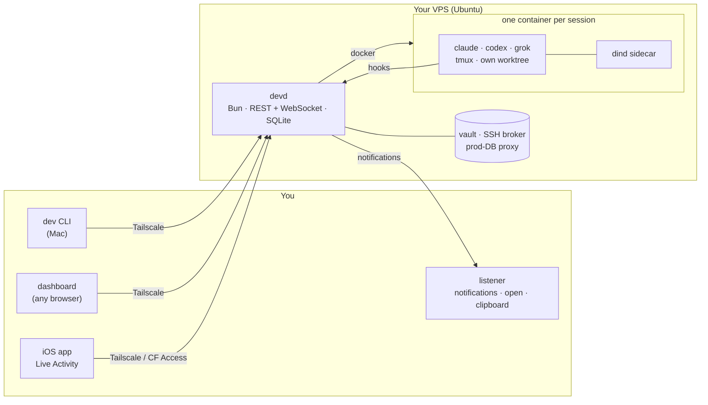

<p align="center">
  
</p>

<h1 align="center">devbox</h1>

<p align="center">
  <b>Your own remote dev environment for AI coding agents.</b><br>
  Claude Code, Codex and Grok in disposable containers on your VPS —<br>
  driven from your Mac, a web dashboard or your iPhone.
</p>

<p align="center">
  <a href="https://github.com/bohous04/devbox/actions/workflows/ci.yml"></a>
  <a href="LICENSE"></a>
  
  
  
</p>

<p align="center">
  
</p>

> **Status:** devbox started as one person's daily setup and is opinionated: Ubuntu VPS,
> Tailscale, macOS client, Warp terminal. It works and is used every day, but expect sharp
> edges. Issues and PRs are welcome — see [CONTRIBUTING.md](CONTRIBUTING.md).

## Why

Coding agents are best when they can run for hours: long refactors, test loops, a dozen
tasks in parallel. Your laptop is the wrong place for that — it sleeps, it overheats, and
every agent fights over the same checkout. devbox moves the agents to a server you own and
keeps you in the loop from wherever you are.

## A session in one command

`dev acme/web` gives the agent its own container, its own git worktree and branch, and a
port range for dev servers — then drops you into its tmux. Close the lid; it keeps going.

<p align="center">
  
</p>

<p align="center">
  
</p>

## What it does

- **Sessions in containers.** One Docker container per session with the repo checked out in
  its own git worktree, the agent in tmux and a private Docker daemon (dind). Several
  sessions can work on the same repo in parallel.
- **Multiple agents.** Claude Code, Codex CLI and Grok Build, plus proxy profiles that run
  Claude Code against other models. Switch a running session to another agent or account.
- **Notifications that matter.** Hooks report when an agent is blocked on a question, needs
  a permission, finishes, or gets stuck. They arrive on the Mac (click → focuses the Warp
  tab) and on the phone (Pushover or the iOS app with a Live Activity).
- **Dashboard.** Sessions with a live web terminal, usage statistics, schedules (cron
  prompts), unpushed work, approvals, settings and host health.
- **Secrets stay on the host.** An encrypted vault unlocked in the dashboard. SSH keys are
  brokered through a per-session ssh-agent socket after a human approves (`srv`). Production
  database access goes through a host proxy with separate write approval.
- **Mac integration.** `open` and `preview` inside a container open files and dev servers
  on your Mac; clipboard images paste into the agent; the workspace is mounted in Finder
  over SMB.
- **Sharing and overflow.** Share a live terminal and its dev-server previews with a guest for
  a limited time; spill sessions over to rented InstaBox VMs when the VPS is full.
- **Upkeep.** Nightly agent updates with safe pane restarts that resume the same
  conversation, auto-deploys of `main` after CI, memory limits per session, offsite-verified
  storage cleanup, borg backups and an external watchdog.

## Dashboard

<table>
  <tr>
    <td width="50%"><br><sub><b>Live terminal</b> — watch or take over any session from the browser.</sub></td>
    <td width="50%"><br><sub><b>Overview</b> — today's work and plan usage per account.</sub></td>
  </tr>
  <tr>
    <td><br><sub><b>Statistics</b> — cost, tokens and active time per project.</sub></td>
    <td><br><sub><b>Approvals</b> — an agent asks for an SSH key; you approve, scoped and time-limited.</sub></td>
  </tr>
  <tr>
    <td><br><sub><b>Production writes</b> — SQL against production runs only after a human says yes.</sub></td>
    <td><br><sub><b>Host health</b> — machines, storage and resource history.</sub></td>
  </tr>
</table>

## On your phone

The iOS app shows every session, lets you answer approvals, and keeps a Live Activity on
the Lock Screen and in the Dynamic Island with what is waiting for you.

<p align="center">
  
  
  
  
</p>

<p align="center">
  
</p>

## Architecture



| Directory | What | Runs on |
|---|---|---|
| `devd/` | control plane: sessions, containers, config, notifications, brokers | VPS (systemd `devd`) |
| `dashboard/` | web UI, served by devd | browser |
| `image/` | Docker image for sessions (agents, MCP, Playwright, hooks, shims) | VPS |
| `infra/` | `bootstrap.sh`, `setup.sh`, systemd units, firewall, backup, auto-update | VPS |
| `cli/` | the `dev` command | Mac |
| `listener/` | Mac agent: open, notifications, notifier app, SMB automount | Mac |
| `ios/` | iOS app: sessions, approvals, Live Activities | iPhone |
| `tools/` | agent-sync, maintenance scripts, and the [demo devd](tools/demo/) behind these screenshots | VPS / Mac |
| `shared/` | types shared between devd and the dashboard | — |

## Requirements

- A VPS with Ubuntu 24.04 (Debian works too). Plan on 4+ vCPU and 8+ GB RAM if you run
  several sessions at once.
- A [Tailscale](https://tailscale.com) tailnet. devd and the dashboard are only reachable
  over it.
- A Mac for the CLI and listener. The dashboard works from any browser on the tailnet.
- Accounts for the agents you want to use (Claude, ChatGPT/Codex, Grok).

Optional: Cloudflare Tunnel + Access (dashboard from outside the tailnet), a 1Password
service account (SSH key broker), Pushover (phone alerts), Beszel/Uptime Kuma (host
monitoring), borg target (backups).

## Quickstart

On a fresh VPS, as root:

```bash
bash <(curl -fsSL https://raw.githubusercontent.com/bohous04/devbox/main/infra/bootstrap.sh)
tailscale up --ssh
bash /opt/vps-dev-infra/infra/setup.sh      # second run binds devd to the tailnet IP
gh auth login && gh auth setup-git
```

Optional components are opt-in, e.g. `DEVBOX_FEATURES="samba op" bash …/setup.sh`.

On the Mac:

```bash
git clone https://github.com/bohous04/devbox ~/devbox && cd ~/devbox && bun install
ln -s "$PWD/cli/src/main.ts" ~/.local/bin/dev
mkdir -p ~/.config/devbox-cli
echo '{ "devdUrl": "http://<vps-tailnet-ip>:4300", "sshHost": "<vps-ssh-host>" }' > ~/.config/devbox-cli/config.json
dev doctor
dev acme/web          # start a session
```

Full guides:

- [docs/install.md](docs/install.md) — server install, vault, firewall, backups, monitoring, upgrades
- [docs/mac.md](docs/mac.md) — Mac client: CLI, listener, notifications, SMB, Warp
- [docs/browser.md](docs/browser.md) — Windows/Linux browser: terminal, Claude login, text/images/files and clipboard
- [docs/ios.md](docs/ios.md) — building the iOS app, connecting it, push and Live Activities
- [docs/configuration.md](docs/configuration.md) — environment variables, files, `secrets.json`, `config.json`
- [SECURITY.md](SECURITY.md) — threat model; **read before giving agents real credentials**

## A note on the account pool

devd can rotate several Claude and Codex subscriptions per session (see
`docs/account-pool.md`). Spreading usage across multiple consumer subscriptions may break
the providers' terms of service and can get accounts suspended. The feature does nothing
until you add accounts. You are responsible for how you use it.

## Contributing

See [CONTRIBUTING.md](CONTRIBUTING.md). Security issues: [SECURITY.md](SECURITY.md).

## License

Copyright 2026 LNRT. [Apache License 2.0](LICENSE), see also [NOTICE](NOTICE). Third-party parts:
[THIRD_PARTY_NOTICES.md](THIRD_PARTY_NOTICES.md).

devbox is an independent project and is not affiliated with Anthropic, OpenAI, xAI,
Tailscale or Warp.
